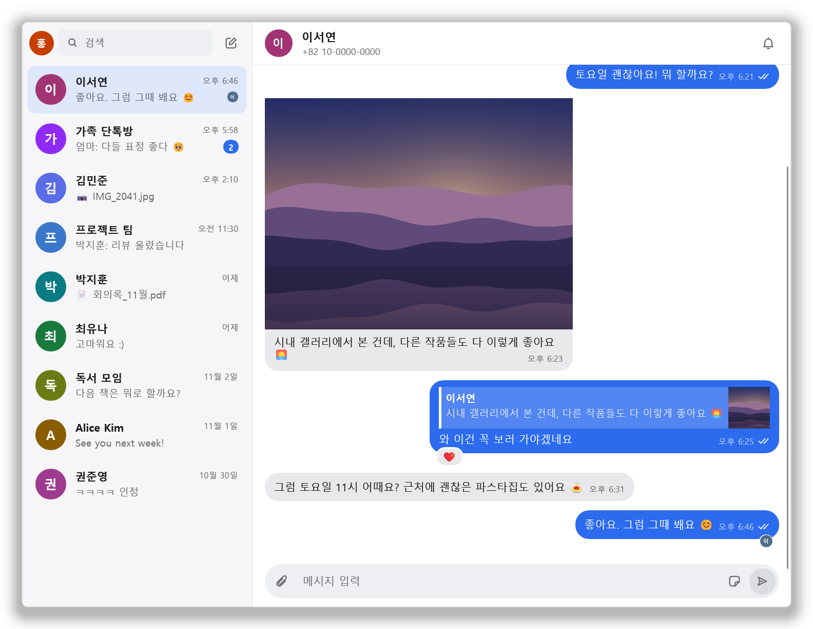
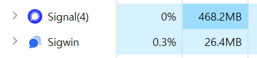
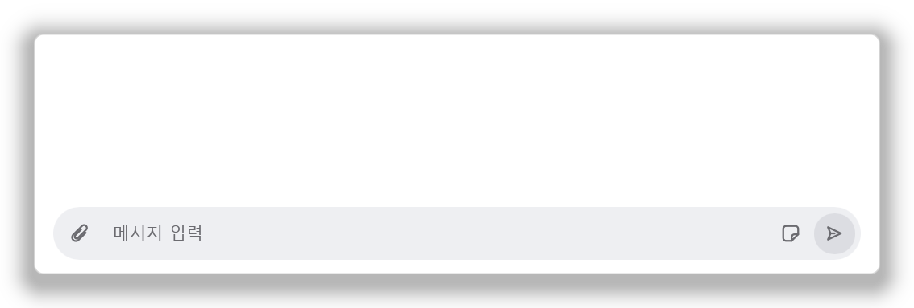
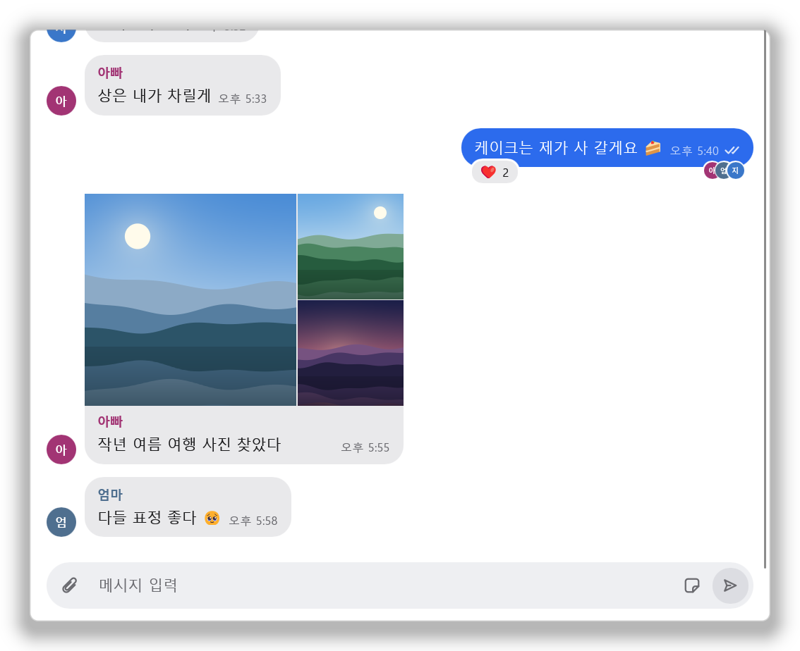
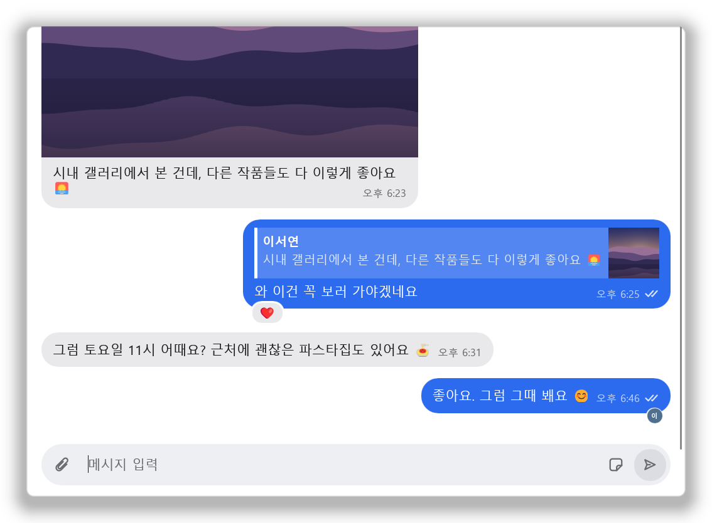
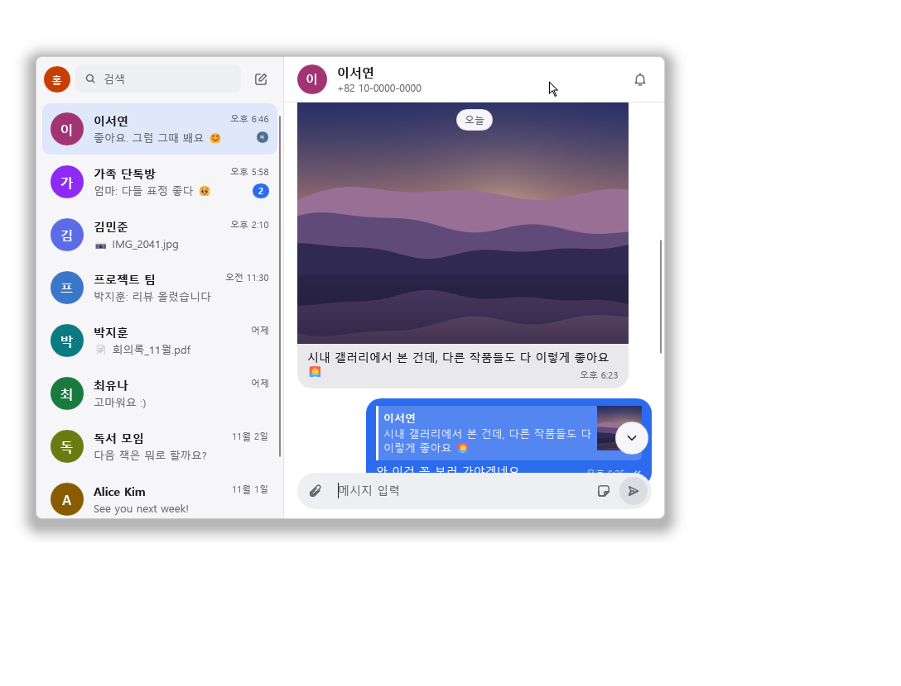
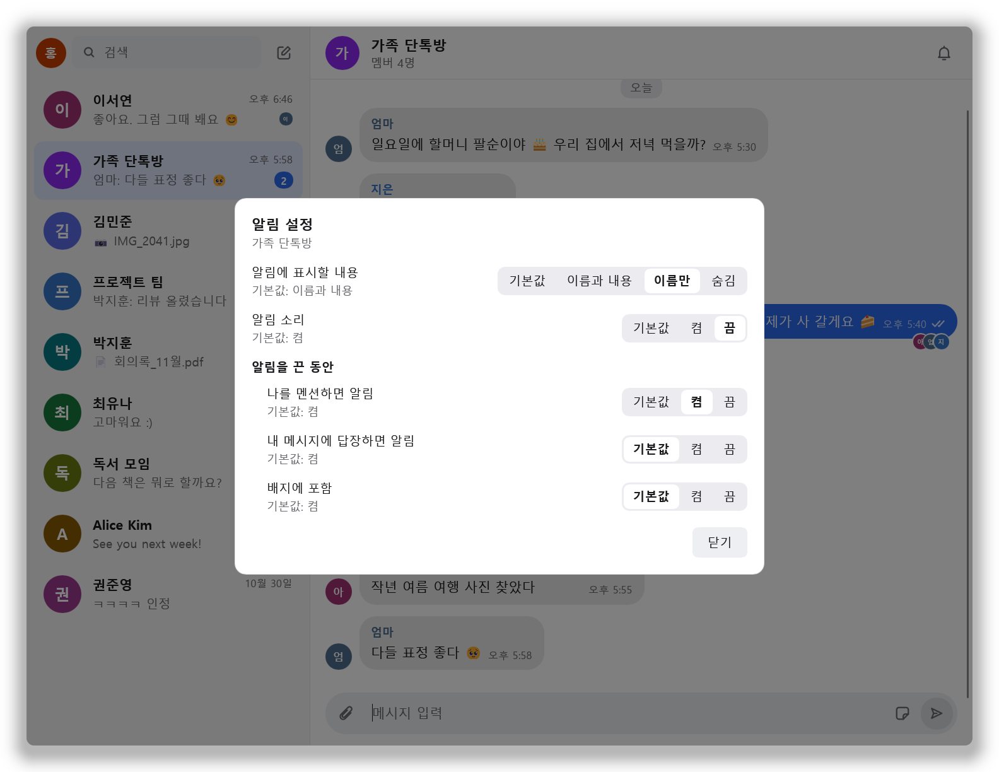

[**Read in English**](README.md) • **한국어**

# Sigwin

### 초경량 Signal 데스크톱 클라이언트 (비공식)

> Signal과 무관한 비공식 클라이언트입니다. "Signal"은 Signal Technology Foundation의 상표입니다.

<picture>
    <source media="(prefers-color-scheme: dark)" srcset="docs/media/hero-ko-dark.png">
    
</picture>

<h3><a href="https://github.com/Othereum/sigwin/releases/latest">📥 최신 버전 다운로드</a></h3>

🌐 English · Deutsch · 한국어

<br>

## 차별점
**Sigwin을 선택해야 하는 이유**

### 가벼움
메모리 사용량이 공식 앱의 1/15도 안 되어, 저사양 PC에서도 부담이 없습니다.

<picture>
    <source media="(prefers-color-scheme: dark)" srcset="docs/media/memory-dark.png">
    
</picture>

### 한글 입력에 강함
글자를 조합하는 중에도 `@멘션`과 검색이 문제없이 동작하고, 초성만으로도 이름을 찾을 수 있습니다.

<picture>
    <source media="(prefers-color-scheme: dark)" srcset="docs/media/ime-dark.png">
    
</picture>

### 읽은 사람 표시
보낸 메시지 아래에 읽은 사람의 프로필 사진이 표시되어 누가 읽었는지 바로 알 수 있습니다.

<picture>
    <source media="(prefers-color-scheme: dark)" srcset="docs/media/readers-ko-dark.png">
    
</picture>

### 기다릴 필요 없는 링크 미리보기
링크를 붙여넣고 미리보기가 뜨기 전에 Enter를 눌러도 미리보기가 포함되어 전송됩니다.

<picture>
    <source media="(prefers-color-scheme: dark)" srcset="docs/media/link-ko-dark.png">
    
</picture>

### 이미지 뷰어
메신저 창이 작아도 이미지가 알맞은 크기의 별도 창으로 열립니다. 휠로 빠르게 확대·축소할 수 있고, 이미지를 클릭하면 바로 닫힙니다.

<picture>
    <source media="(prefers-color-scheme: dark)" srcset="docs/media/viewer-ko-dark.png">
    
</picture>

### 대화별 알림 설정
알림 내용·소리·배지를 대화마다 정할 수 있고, 휴대폰에서 동기화된 알림 설정도 이 PC에서만 바꿀 수 있습니다.

<picture>
    <source media="(prefers-color-scheme: dark)" srcset="docs/media/notify-ko-dark.png">
    
</picture>

## 기능
- **대화**: 1:1·그룹, 새 대화 시작, 메시지 요청, 답장, 수정, 삭제, 반응, @멘션, 글자 서식, 메시지 고정, 읽음 확인, 메시지 검색
- **첨부**: 사진·동영상·파일, 스티커, 움직이는 GIF·WebP·APNG, 대화의 미디어·파일 모아 보기
- **알림**: Windows 알림, 안 읽은 수 배지
- **상주**: 창을 닫아도 트레이에서 계속 실행, 로그인 시 자동 실행, 자동 업데이트
- **시작**: QR 코드로 휴대폰에 **연결된 기기**로 등록, 휴대폰의 최근 대화 기록 가져오기
- **보안**: 로컬 데이터 암호화. 키는 Windows DPAPI로 보호합니다.
- **언어**: English, Deutsch, 한국어

### 미지원
음성·영상 통화, 스토리, 스티커 팩 삭제, 결제, 한 번 보기 미디어, 사라지는 메시지 타이머 변경, 알림 프로필

## 메모리 절약 설계
**Rust**로 작성했고, Signal 프로토콜은 [presage](https://github.com/whisperfish/presage), UI는 [Slint](https://slint.dev)를 씁니다.

- Slint **소프트웨어 렌더러** 사용 (femtovg 212MB, Skia 388MB 대비 private 8.4MB)
- 메시지는 60행씩 조회하고, 대화창에는 최대 600행만 유지
- 이미지는 썸네일만 메모리에 올리고 나머지는 디스크 캐시
- 움직이는 스티커는 보이는 크기로 압축해 두고 한 프레임씩 디코딩
- 파일 선택 대화상자는 자식 프로세스에서 실행
- 자세한 측정과 결정 배경은 [`docs/decisions.md`](docs/decisions.md)

## 빌드 (Windows)
필요한 도구: Rust(stable), protoc, LLVM(clang), NASM, CMake

```powershell
winget install Google.Protobuf LLVM.LLVM NASM.NASM Kitware.CMake
cargo build --profile fast   # 개발용
cargo build --release        # 배포용 (thin LTO)
cargo test
```
- 결과물은 `target\fast\` 또는 `target\release\`에 생깁니다.
- LLVM이 기본 경로(`C:\Program Files\LLVM\bin`)에 없으면 `LIBCLANG_PATH`로, protoc는 `PATH` 또는 `PROTOC`로 지정하세요.
- 앱이 실행 중이면 exe가 잠겨 빌드가 실패하니 먼저 종료하세요.
- `target` 아래의 exe는 설치 단계를 건너뛰고 그 자리에서 실행됩니다.

## 실행
```powershell
target\fast\sigwin.exe
```
| 환경 변수 | 용도 |
|---|---|
| `SIGWIN_DATA` | 데이터 폴더 (기본값 `%LOCALAPPDATA%\Sigwin\data`) |
| `RUST_LOG` | 로그 레벨 (예: `info,sigwin=debug`) |
| `SIGWIN_DEMO=1` | 계정 없이 가짜 데이터로 UI 확인 |

그 밖의 데모·헤드리스 옵션은 [`docs/headless.md`](docs/headless.md)를 보세요.

## 라이선스
AGPL-3.0-only (presage, libsignal과 동일). 전문은 [`LICENSE`](LICENSE)에 있습니다. 포함된 라이브러리의 고지는 앱의 `⚙` → 정보 → 오픈소스 라이선스, 또는 릴리스의 `licenses.html`에 있습니다.
