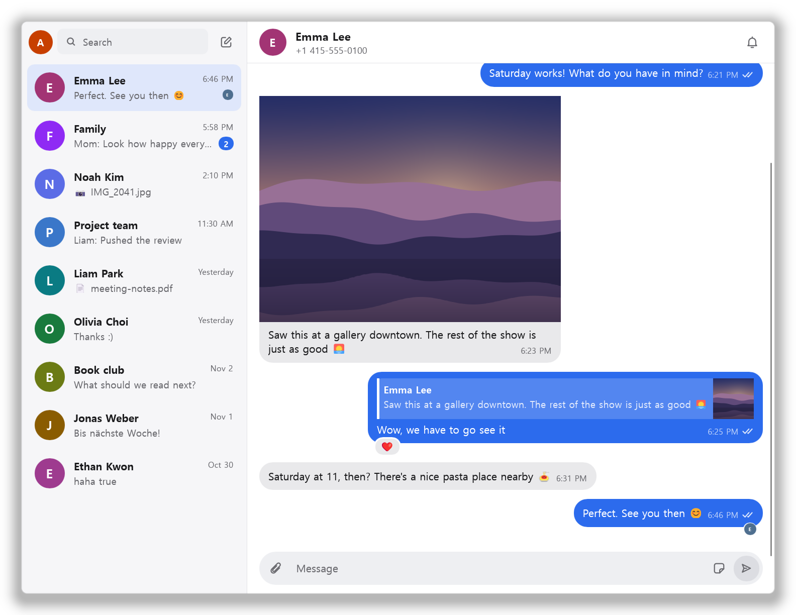
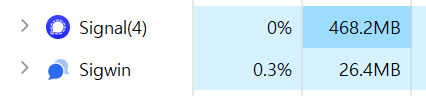
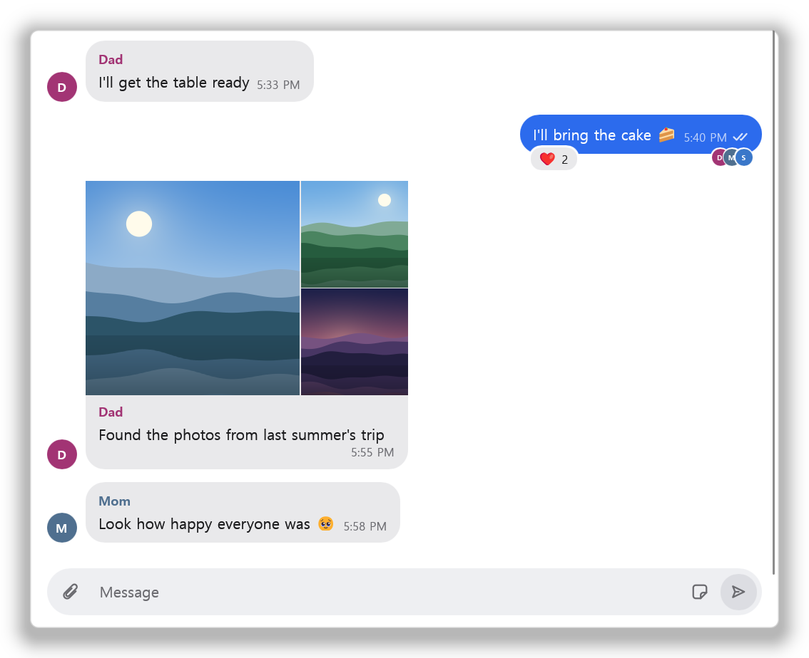
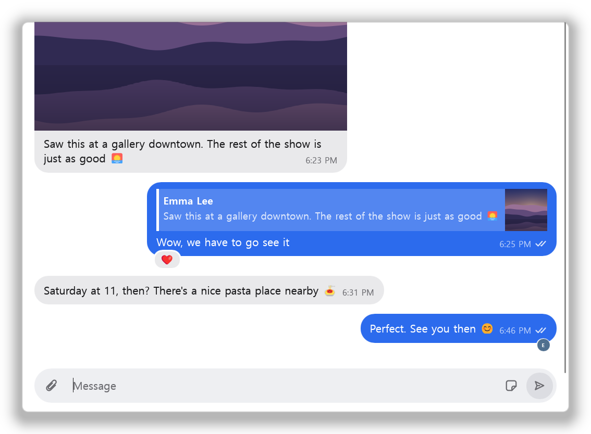
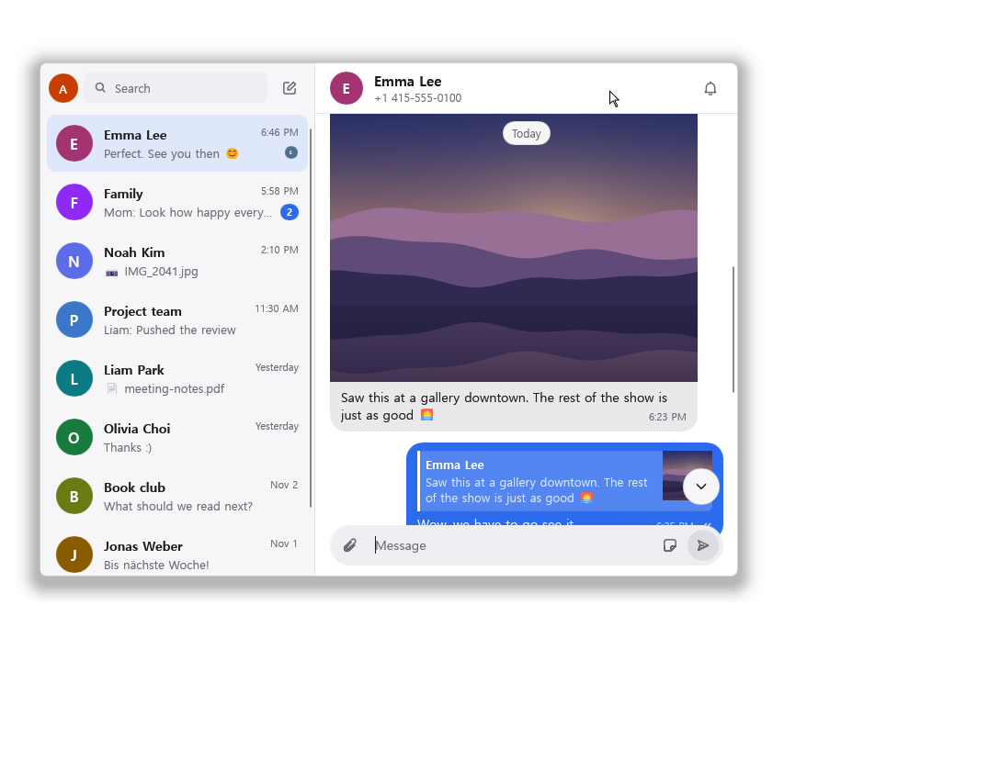
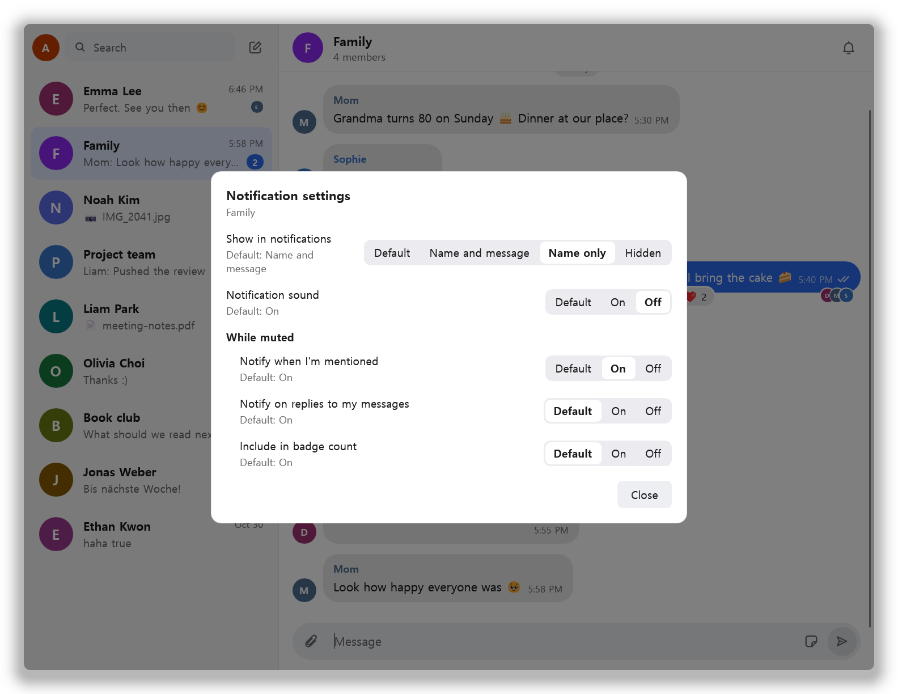
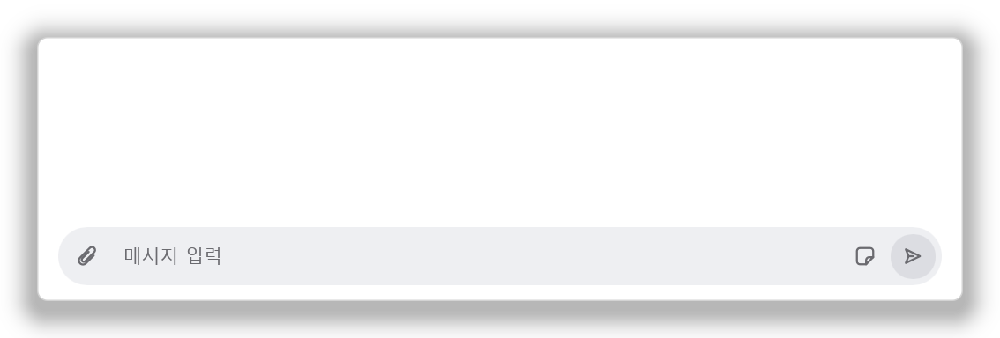

**English** • [**한국어로 읽기**](README.ko.md)

# Sigwin

### An ultra-light Signal desktop client (unofficial)

> An unofficial client, not affiliated with Signal. "Signal" is a trademark of the Signal Technology Foundation.

<picture>
    <source media="(prefers-color-scheme: dark)" srcset="docs/media/hero-en-dark.png">
    
</picture>

<h3><a href="https://github.com/Othereum/sigwin/releases/latest">📥 Download the latest version</a></h3>

🌐 English · Deutsch · 한국어

<br>

## Why Sigwin

### Light
Uses less than 1/15 of the official app's memory, so even a low-end PC runs it with ease.

<picture>
    <source media="(prefers-color-scheme: dark)" srcset="docs/media/memory-dark.png">
    
</picture>

### See who read it
The profile photos of those who read your message show under it.

<picture>
    <source media="(prefers-color-scheme: dark)" srcset="docs/media/readers-en-dark.png">
    
</picture>

### No waiting for link previews
Paste a link and press Enter before the preview appears: it is still sent with the preview.

<picture>
    <source media="(prefers-color-scheme: dark)" srcset="docs/media/link-en-dark.png">
    
</picture>

### Image viewer
Images open in their own window at a fitting size, even when the chat window is small. Zoom fast with the wheel; click the image to close it.

<picture>
    <source media="(prefers-color-scheme: dark)" srcset="docs/media/viewer-en-dark.png">
    
</picture>

### Per-chat notification settings
Set notification content, sound and badge for each chat, and override the settings synced from your phone on this PC only.

<picture>
    <source media="(prefers-color-scheme: dark)" srcset="docs/media/notify-en-dark.png">
    
</picture>

### For Korean, Japanese and Chinese input
`@mentions` and search find people while a character is still being composed, so you don't have to finish it first. Korean names are also found by their initial consonants alone.

<picture>
    <source media="(prefers-color-scheme: dark)" srcset="docs/media/ime-dark.png">
    
</picture>

## Features
- **Chats**: 1:1 and groups, starting a chat, message requests, replies, edits, deletes, reactions, @mentions, text formatting, pinned messages, read receipts, message search with filters, jump to a date
- **Attachments**: photos, videos and files, stickers and making sticker packs, animated GIF, WebP and APNG, view-once photos, all of a chat's media and files in one place
- **Notifications**: Windows notifications, unread badge
- **Always on**: keeps running in the tray when the window is closed, opens at login, updates itself
- **Getting started**: links to your phone as a **linked device** with a QR code, brings over your recent chat history from the phone
- **Security**: local data is encrypted, with the key protected by Windows DPAPI; screen security keeps the window out of screenshots
- **Languages**: English, Deutsch, 한국어

### Not supported
Voice and video calls, stories, removing sticker packs, payments, view-once videos, changing the disappearing message timer, notification profiles

## Designed for low memory
Written in **Rust**, with [presage](https://github.com/whisperfish/presage) for the Signal protocol and [Slint](https://slint.dev) for the UI.

- Slint's **software renderer** (8.4MB private, against 212MB for femtovg and 388MB for Skia)
- Messages are read 60 rows at a time, and a chat holds at most 600 rows
- Only thumbnails of images are kept in memory; the rest is cached on disk
- Animated stickers are kept compressed at the size shown and decoded a frame at a time
- File dialogs run in a child process
- Measurements and the reasons behind these choices: [`docs/decisions.md`](docs/decisions.md)

## Building (Windows)
You need Rust (stable), protoc, LLVM (clang), NASM and CMake.

```powershell
winget install Google.Protobuf LLVM.LLVM NASM.NASM Kitware.CMake
cargo build --profile fast   # day to day
cargo build --release        # for distribution (thin LTO)
cargo test
```
- The build goes to `target\fast\` or `target\release\`.
- If LLVM isn't in its default place (`C:\Program Files\LLVM\bin`), set `LIBCLANG_PATH`; set protoc with `PATH` or `PROTOC`.
- A running app locks its exe and the build fails, so quit it first.
- An exe under `target` skips installing and runs where it is.

## Running
```powershell
target\fast\sigwin.exe
```
| Environment variable | Use |
|---|---|
| `SIGWIN_DATA` | data folder (default `%LOCALAPPDATA%\Sigwin\data`) |
| `RUST_LOG` | log level (e.g. `info,sigwin=debug`) |
| `SIGWIN_DEMO=1` | try the UI with fake data, no account |
| `SIGWIN_LANG` | UI language for this run (`en`, `de`, `ko`), over the setting |

More demo and headless options: [`docs/headless.md`](docs/headless.md).

## License
AGPL-3.0-only (the same as presage and libsignal). The full text is in [`LICENSE`](LICENSE). Notices for the included libraries are in the app under `⚙` → About → Open source licenses, or in a release's `licenses.html`.
